# Database Architecture, Schema Specification & RLS Security

**Project:** WealthOvers — Advanced Personal Money Manager Web Application  
**Database Engine:** PostgreSQL 15+ (Hosted on Supabase Cloud)  
**ORM / Query Builder:** Drizzle ORM + Supabase SQL Client  
**Security Model:** Mandatory PostgreSQL Row Level Security (RLS)  

---

## 1. Database Architectural Principles & Standards

1. **Third Normal Form (3NF) Integrity**:
   - Entities are fully normalized to prevent write anomalies, data redundancy, and inconsistent updates.
   - Denormalized aggregate fields (such as `accounts.current_balance`) are maintained strictly via transactional database triggers rather than application-layer updates, ensuring atomic consistency.
2. **Identifier Standards**:
   - All primary keys use universally unique identifiers (`UUID`) generated via PostgreSQL's native `gen_random_uuid()` function.
   - All user-owned tables contain a foreign key `user_id UUID NOT NULL REFERENCES auth.users(id) ON DELETE CASCADE`.
3. **Monetary & Arithmetic Precision**:
   - Floating-point data types (`REAL`, `FLOAT`, `DOUBLE PRECISION`) are prohibited.
   - All currency values, fee amounts, and tax quantities are defined as `NUMERIC(15, 4)`.
   - All asset holdings, share counts, and mutual fund units are defined as `NUMERIC(18, 6)`.
   - All percentages (interest rates, returns) are defined as `NUMERIC(6, 4)` (e.g., `12.5000%`).
4. **Temporal Standards**:
   - All timestamp fields use `TIMESTAMPTZ` (Timestamp with Time Zone), defaulting to `NOW()`.
   - Every mutable table contains `created_at` and `updated_at` columns backed by an automated update trigger.
5. **Zero-Trust Access Control**:
   - Every single table in the `public` schema has `ROW LEVEL SECURITY` enabled and forced.
   - Every client-facing query implicitly resolves through PostgreSQL RLS filters checking `auth.uid() = user_id`.

---

## 2. Database Entity Relationship Diagram (ERD)

```mermaid
erDiagram
    USERS ||--o{ PROFILES : owns
    USERS ||--o{ USER_SETTINGS : configures
    USERS ||--o{ ACCOUNTS : owns
    USERS ||--o{ CATEGORIES : defines
    CATEGORIES ||--o{ SUBCATEGORIES : contains
    USERS ||--o{ MERCHANTS : tracks
    USERS ||--o{ TRANSACTIONS : records
    ACCOUNTS ||--o{ TRANSACTIONS : source_of
    ACCOUNTS ||--o{ TRANSACTIONS : destination_of
    CATEGORIES ||--o{ TRANSACTIONS : categorizes
    SUBCATEGORIES ||--o{ TRANSACTIONS : subcategorizes
    MERCHANTS ||--o{ TRANSACTIONS : associates
    USERS ||--o{ BUDGETS : plans
    BUDGETS ||--o{ BUDGET_CATEGORIES : allocates
    CATEGORIES ||--o{ BUDGET_CATEGORIES : scoped_to
    USERS ||--o{ RECURRING_TRANSACTIONS : schedules
    USERS ||--o{ SUBSCRIPTIONS : tracks
    USERS ||--o{ INVESTMENTS : holds
    INVESTMENTS ||--o{ INVESTMENT_TRANSACTIONS : logs
    USERS ||--o{ CREDIT_CARDS : manages
    CREDIT_CARDS ||--o{ CREDIT_CARD_STATEMENTS : issues
    USERS ||--o{ LOANS : contracts
    LOANS ||--o{ LOAN_PAYMENTS : repays
    USERS ||--o{ ASSETS : owns
    USERS ||--o{ LIABILITIES : owes
    USERS ||--o{ FINANCIAL_GOALS : targets
    FINANCIAL_GOALS ||--o{ GOAL_CONTRIBUTIONS : funds
    USERS ||--o{ DEVICES : registers
    DEVICES ||--o{ SYNC_LOGS : generates
    USERS ||--o{ IMPORT_JOBS : executes
    USERS ||--o{ CATEGORIZATION_RULES : automates
    USERS ||--o{ AUDIT_LOGS : records

    PROFILES {
        uuid id PK
        text email
        text full_name
        text avatar_url
        text phone_number
        timestamptz created_at
        timestamptz updated_at
    }

    USER_SETTINGS {
        uuid id PK
        uuid user_id FK
        varchar currency
        varchar locale
        int financial_year_start_month
        varchar timezone
        boolean is_privacy_mode
        boolean dark_mode
    }

    ACCOUNTS {
        uuid id PK
        uuid user_id FK
        varchar name
        varchar account_type
        varchar institution_name
        varchar account_number_masked
        varchar currency
        numeric initial_balance
        numeric current_balance
        varchar color
        varchar icon
        boolean is_archived
    }

    TRANSACTIONS {
        uuid id PK
        uuid user_id FK
        uuid account_id FK
        uuid destination_account_id FK
        uuid category_id FK
        uuid subcategory_id FK
        uuid merchant_id FK
        numeric amount
        varchar currency
        varchar transaction_type
        timestamptz transaction_date
        text description
        text notes
        varchar source
        varchar reference_number
        varchar idempotency_hash
        boolean is_reviewed
    }

    BUDGETS {
        uuid id PK
        uuid user_id FK
        varchar name
        numeric total_amount
        date start_date
        date end_date
        boolean rollover_enabled
    }

    INVESTMENTS {
        uuid id PK
        uuid user_id FK
        varchar symbol
        varchar asset_type
        varchar broker_name
        numeric total_quantity
        numeric average_buy_price
        numeric current_nav_or_price
        numeric total_invested_amount
        numeric current_valuation
        varchar currency
    }

    CREDIT_CARDS {
        uuid id PK
        uuid user_id FK
        uuid account_id FK
        varchar card_name
        varchar last_four_digits
        numeric credit_limit
        numeric current_outstanding
        int billing_cycle_day
        int payment_due_day
    }

    LOANS {
        uuid id PK
        uuid user_id FK
        varchar loan_type
        varchar lender_name
        numeric principal_amount
        numeric interest_rate_apr
        numeric monthly_emi
        numeric outstanding_balance
        date start_date
        date maturity_date
    }
```



---

## 3. Production PostgreSQL DDL Schema

The following SQL DDL creates the complete schema, indexes, constraints, triggers, and RLS policies for WealthOvers.

```sql
-- ============================================================================
-- 1. EXTENSIONS & CUSTOM DOMAINS
-- ============================================================================
CREATE EXTENSION IF NOT EXISTS "uuid-ossp";
CREATE EXTENSION IF NOT EXISTS "pgcrypto";

-- Enum Definitions
CREATE TYPE account_type_enum AS ENUM (
    'savings',
    'current',
    'salary',
    'cash',
    'upi_wallet',
    'fixed_deposit',
    'recurring_deposit',
    'credit_card',
    'loan_account',
    'investment_demat',
    'other'
);

CREATE TYPE transaction_type_enum AS ENUM (
    'income',
    'expense',
    'transfer',
    'refund',
    'investment_buy',
    'investment_sell',
    'loan_disbursement',
    'loan_repayment'
);

CREATE TYPE transaction_source_enum AS ENUM (
    'manual',
    'csv_import',
    'xlsx_import',
    'pdf_import',
    'android_sms_sync',
    'notification_sync',
    'recurring_rule'
);

CREATE TYPE recurrence_interval_enum AS ENUM (
    'daily',
    'weekly',
    'biweekly',
    'monthly',
    'quarterly',
    'half_yearly',
    'yearly'
);

CREATE TYPE investment_type_enum AS ENUM (
    'stock_in',
    'stock_us',
    'mutual_fund',
    'etf',
    'sovereign_gold_bond',
    'gold_physical',
    'gold_digital',
    'fixed_deposit',
    'recurring_deposit',
    'ppf',
    'epf',
    'nps',
    'crypto',
    'other'
);

CREATE TYPE loan_type_enum AS ENUM (
    'personal',
    'home',
    'education',
    'vehicle',
    'credit_card_debt',
    'loan_given',
    'loan_received',
    'other'
);

CREATE TYPE device_status_enum AS ENUM (
    'active',
    'revoked',
    'pending_approval'
);

CREATE TYPE import_status_enum AS ENUM (
    'pending',
    'processing',
    'completed',
    'failed'
);

-- ============================================================================
-- 2. CORE USERS & PROFILES
-- ============================================================================
CREATE TABLE public.profiles (
    id UUID PRIMARY KEY REFERENCES auth.users(id) ON DELETE CASCADE,
    email TEXT NOT NULL,
    full_name TEXT NOT NULL DEFAULT '',
    avatar_url TEXT,
    phone_number TEXT,
    created_at TIMESTAMPTZ NOT NULL DEFAULT NOW(),
    updated_at TIMESTAMPTZ NOT NULL DEFAULT NOW()
);

CREATE TABLE public.user_settings (
    id UUID PRIMARY KEY DEFAULT gen_random_uuid(),
    user_id UUID NOT NULL UNIQUE REFERENCES auth.users(id) ON DELETE CASCADE,
    currency VARCHAR(3) NOT NULL DEFAULT 'INR',
    locale VARCHAR(10) NOT NULL DEFAULT 'en-IN',
    financial_year_start_month SMALLINT NOT NULL DEFAULT 4 CHECK (financial_year_start_month BETWEEN 1 AND 12),
    timezone VARCHAR(50) NOT NULL DEFAULT 'Asia/Kolkata',
    is_privacy_mode BOOLEAN NOT NULL DEFAULT FALSE,
    theme_preference VARCHAR(10) NOT NULL DEFAULT 'system',
    created_at TIMESTAMPTZ NOT NULL DEFAULT NOW(),
    updated_at TIMESTAMPTZ NOT NULL DEFAULT NOW()
);

-- ============================================================================
-- 3. ACCOUNTS
-- ============================================================================
CREATE TABLE public.accounts (
    id UUID PRIMARY KEY DEFAULT gen_random_uuid(),
    user_id UUID NOT NULL REFERENCES auth.users(id) ON DELETE CASCADE,
    name VARCHAR(100) NOT NULL,
    account_type account_type_enum NOT NULL DEFAULT 'savings',
    institution_name VARCHAR(100) NOT NULL DEFAULT 'Cash / Generic',
    account_number_masked VARCHAR(20),
    currency VARCHAR(3) NOT NULL DEFAULT 'INR',
    initial_balance NUMERIC(15, 4) NOT NULL DEFAULT 0.0000,
    current_balance NUMERIC(15, 4) NOT NULL DEFAULT 0.0000,
    color VARCHAR(20) NOT NULL DEFAULT '#3B82F6',
    icon VARCHAR(50) NOT NULL DEFAULT 'Wallet',
    is_archived BOOLEAN NOT NULL DEFAULT FALSE,
    created_at TIMESTAMPTZ NOT NULL DEFAULT NOW(),
    updated_at TIMESTAMPTZ NOT NULL DEFAULT NOW()
);

-- ============================================================================
-- 4. CATEGORIES, SUBCATEGORIES & MERCHANTS
-- ============================================================================
CREATE TABLE public.categories (
    id UUID PRIMARY KEY DEFAULT gen_random_uuid(),
    user_id UUID NOT NULL REFERENCES auth.users(id) ON DELETE CASCADE,
    name VARCHAR(80) NOT NULL,
    type VARCHAR(10) NOT NULL CHECK (type IN ('income', 'expense', 'investment')),
    icon VARCHAR(50) NOT NULL DEFAULT 'Folder',
    color VARCHAR(20) NOT NULL DEFAULT '#6B7280',
    is_system BOOLEAN NOT NULL DEFAULT FALSE,
    created_at TIMESTAMPTZ NOT NULL DEFAULT NOW(),
    updated_at TIMESTAMPTZ NOT NULL DEFAULT NOW(),
    CONSTRAINT uq_user_category UNIQUE (user_id, name, type)
);

CREATE TABLE public.subcategories (
    id UUID PRIMARY KEY DEFAULT gen_random_uuid(),
    user_id UUID NOT NULL REFERENCES auth.users(id) ON DELETE CASCADE,
    category_id UUID NOT NULL REFERENCES public.categories(id) ON DELETE CASCADE,
    name VARCHAR(80) NOT NULL,
    icon VARCHAR(50),
    created_at TIMESTAMPTZ NOT NULL DEFAULT NOW(),
    updated_at TIMESTAMPTZ NOT NULL DEFAULT NOW(),
    CONSTRAINT uq_category_subcategory UNIQUE (category_id, name)
);

CREATE TABLE public.merchants (
    id UUID PRIMARY KEY DEFAULT gen_random_uuid(),
    user_id UUID NOT NULL REFERENCES auth.users(id) ON DELETE CASCADE,
    name VARCHAR(120) NOT NULL,
    default_category_id UUID REFERENCES public.categories(id) ON DELETE SET NULL,
    logo_url TEXT,
    created_at TIMESTAMPTZ NOT NULL DEFAULT NOW(),
    updated_at TIMESTAMPTZ NOT NULL DEFAULT NOW(),
    CONSTRAINT uq_user_merchant UNIQUE (user_id, name)
);

CREATE TABLE public.categorization_rules (
    id UUID PRIMARY KEY DEFAULT gen_random_uuid(),
    user_id UUID NOT NULL REFERENCES auth.users(id) ON DELETE CASCADE,
    keyword_pattern TEXT NOT NULL,
    match_field VARCHAR(20) NOT NULL DEFAULT 'description' CHECK (match_field IN ('description', 'merchant', 'reference')),
    target_category_id UUID NOT NULL REFERENCES public.categories(id) ON DELETE CASCADE,
    target_subcategory_id UUID REFERENCES public.subcategories(id) ON DELETE SET NULL,
    priority INT NOT NULL DEFAULT 0,
    created_at TIMESTAMPTZ NOT NULL DEFAULT NOW(),
    updated_at TIMESTAMPTZ NOT NULL DEFAULT NOW()
);

-- ============================================================================
-- 5. TRANSACTIONS LEDGER
-- ============================================================================
CREATE TABLE public.transactions (
    id UUID PRIMARY KEY DEFAULT gen_random_uuid(),
    user_id UUID NOT NULL REFERENCES auth.users(id) ON DELETE CASCADE,
    account_id UUID NOT NULL REFERENCES public.accounts(id) ON DELETE CASCADE,
    destination_account_id UUID REFERENCES public.accounts(id) ON DELETE RESTRICT,
    category_id UUID REFERENCES public.categories(id) ON DELETE SET NULL,
    subcategory_id UUID REFERENCES public.subcategories(id) ON DELETE SET NULL,
    merchant_id UUID REFERENCES public.merchants(id) ON DELETE SET NULL,
    amount NUMERIC(15, 4) NOT NULL CHECK (amount >= 0),
    currency VARCHAR(3) NOT NULL DEFAULT 'INR',
    transaction_type transaction_type_enum NOT NULL,
    transaction_date TIMESTAMPTZ NOT NULL,
    description TEXT NOT NULL DEFAULT '',
    notes TEXT,
    source transaction_source_enum NOT NULL DEFAULT 'manual',
    reference_number VARCHAR(100),
    original_transaction_id UUID REFERENCES public.transactions(id) ON DELETE SET NULL,
    idempotency_hash VARCHAR(64),
    is_reviewed BOOLEAN NOT NULL DEFAULT TRUE,
    parser_confidence NUMERIC(4, 3) DEFAULT 1.000,
    tags TEXT[] DEFAULT '{}',
    created_at TIMESTAMPTZ NOT NULL DEFAULT NOW(),
    updated_at TIMESTAMPTZ NOT NULL DEFAULT NOW()
);

-- ============================================================================
-- 6. BUDGETS & PLANNING
-- ============================================================================
CREATE TABLE public.budgets (
    id UUID PRIMARY KEY DEFAULT gen_random_uuid(),
    user_id UUID NOT NULL REFERENCES auth.users(id) ON DELETE CASCADE,
    name VARCHAR(100) NOT NULL,
    total_amount NUMERIC(15, 4) NOT NULL CHECK (total_amount >= 0),
    period_type VARCHAR(20) NOT NULL DEFAULT 'monthly' CHECK (period_type IN ('monthly', 'quarterly', 'yearly', 'custom')),
    start_date DATE NOT NULL,
    end_date DATE NOT NULL,
    rollover_enabled BOOLEAN NOT NULL DEFAULT FALSE,
    rolled_over_amount NUMERIC(15, 4) NOT NULL DEFAULT 0.0000,
    alert_threshold_percent SMALLINT NOT NULL DEFAULT 85,
    created_at TIMESTAMPTZ NOT NULL DEFAULT NOW(),
    updated_at TIMESTAMPTZ NOT NULL DEFAULT NOW()
);

CREATE TABLE public.budget_categories (
    id UUID PRIMARY KEY DEFAULT gen_random_uuid(),
    budget_id UUID NOT NULL REFERENCES public.budgets(id) ON DELETE CASCADE,
    category_id UUID NOT NULL REFERENCES public.categories(id) ON DELETE CASCADE,
    allocated_amount NUMERIC(15, 4) NOT NULL CHECK (allocated_amount >= 0),
    created_at TIMESTAMPTZ NOT NULL DEFAULT NOW(),
    updated_at TIMESTAMPTZ NOT NULL DEFAULT NOW(),
    CONSTRAINT uq_budget_category UNIQUE (budget_id, category_id)
);

-- ============================================================================
-- 7. RECURRING BILLS & SUBSCRIPTIONS
-- ============================================================================
CREATE TABLE public.recurring_transactions (
    id UUID PRIMARY KEY DEFAULT gen_random_uuid(),
    user_id UUID NOT NULL REFERENCES auth.users(id) ON DELETE CASCADE,
    account_id UUID NOT NULL REFERENCES public.accounts(id) ON DELETE CASCADE,
    category_id UUID REFERENCES public.categories(id) ON DELETE SET NULL,
    merchant_id UUID REFERENCES public.merchants(id) ON DELETE SET NULL,
    name VARCHAR(120) NOT NULL,
    amount NUMERIC(15, 4) NOT NULL CHECK (amount >= 0),
    currency VARCHAR(3) NOT NULL DEFAULT 'INR',
    transaction_type transaction_type_enum NOT NULL DEFAULT 'expense',
    recurrence_interval recurrence_interval_enum NOT NULL DEFAULT 'monthly',
    interval_count INT NOT NULL DEFAULT 1,
    start_date DATE NOT NULL,
    end_date DATE,
    next_occurrence_date DATE NOT NULL,
    auto_record BOOLEAN NOT NULL DEFAULT FALSE,
    is_active BOOLEAN NOT NULL DEFAULT TRUE,
    created_at TIMESTAMPTZ NOT NULL DEFAULT NOW(),
    updated_at TIMESTAMPTZ NOT NULL DEFAULT NOW()
);

CREATE TABLE public.subscriptions (
    id UUID PRIMARY KEY DEFAULT gen_random_uuid(),
    user_id UUID NOT NULL REFERENCES auth.users(id) ON DELETE CASCADE,
    name VARCHAR(100) NOT NULL,
    billing_cycle recurrence_interval_enum NOT NULL DEFAULT 'monthly',
    cost NUMERIC(15, 4) NOT NULL CHECK (cost >= 0),
    currency VARCHAR(3) NOT NULL DEFAULT 'INR',
    account_id UUID REFERENCES public.accounts(id) ON DELETE SET NULL,
    category_id UUID REFERENCES public.categories(id) ON DELETE SET NULL,
    renewal_date DATE NOT NULL,
    cancellation_reminder_days INT NOT NULL DEFAULT 3,
    status VARCHAR(20) NOT NULL DEFAULT 'active' CHECK (status IN ('active', 'paused', 'cancelled')),
    created_at TIMESTAMPTZ NOT NULL DEFAULT NOW(),
    updated_at TIMESTAMPTZ NOT NULL DEFAULT NOW()
);

-- ============================================================================
-- 8. INVESTMENTS & PORTFOLIO ENGINE
-- ============================================================================
CREATE TABLE public.investments (
    id UUID PRIMARY KEY DEFAULT gen_random_uuid(),
    user_id UUID NOT NULL REFERENCES auth.users(id) ON DELETE CASCADE,
    account_id UUID REFERENCES public.accounts(id) ON DELETE SET NULL,
    name VARCHAR(150) NOT NULL,
    symbol VARCHAR(30),
    asset_type investment_type_enum NOT NULL,
    broker_name VARCHAR(100) NOT NULL DEFAULT 'Manual',
    currency VARCHAR(3) NOT NULL DEFAULT 'INR',
    total_quantity NUMERIC(18, 6) NOT NULL DEFAULT 0.000000 CHECK (total_quantity >= 0),
    average_buy_price NUMERIC(15, 4) NOT NULL DEFAULT 0.0000 CHECK (average_buy_price >= 0),
    total_invested_amount NUMERIC(15, 4) NOT NULL DEFAULT 0.0000 CHECK (total_invested_amount >= 0),
    current_nav_or_price NUMERIC(15, 4) NOT NULL DEFAULT 0.0000 CHECK (current_nav_or_price >= 0),
    current_valuation NUMERIC(15, 4) NOT NULL DEFAULT 0.0000 CHECK (current_valuation >= 0),
    last_price_update_at TIMESTAMPTZ,
    notes TEXT,
    created_at TIMESTAMPTZ NOT NULL DEFAULT NOW(),
    updated_at TIMESTAMPTZ NOT NULL DEFAULT NOW()
);

CREATE TABLE public.investment_transactions (
    id UUID PRIMARY KEY DEFAULT gen_random_uuid(),
    investment_id UUID NOT NULL REFERENCES public.investments(id) ON DELETE CASCADE,
    user_id UUID NOT NULL REFERENCES auth.users(id) ON DELETE CASCADE,
    transaction_type VARCHAR(15) NOT NULL CHECK (transaction_type IN ('buy', 'sell', 'dividend', 'split', 'bonus')),
    transaction_date TIMESTAMPTZ NOT NULL,
    quantity NUMERIC(18, 6) NOT NULL CHECK (quantity > 0),
    unit_price NUMERIC(15, 4) NOT NULL CHECK (unit_price >= 0),
    fees_and_taxes NUMERIC(15, 4) NOT NULL DEFAULT 0.0000 CHECK (fees_and_taxes >= 0),
    total_amount NUMERIC(15, 4) NOT NULL CHECK (total_amount >= 0),
    notes TEXT,
    created_at TIMESTAMPTZ NOT NULL DEFAULT NOW(),
    updated_at TIMESTAMPTZ NOT NULL DEFAULT NOW()
);

-- ============================================================================
-- 9. CREDIT CARDS & DEBT MANAGEMENT
-- ============================================================================
CREATE TABLE public.credit_cards (
    id UUID PRIMARY KEY DEFAULT gen_random_uuid(),
    user_id UUID NOT NULL REFERENCES auth.users(id) ON DELETE CASCADE,
    account_id UUID NOT NULL UNIQUE REFERENCES public.accounts(id) ON DELETE CASCADE,
    card_name VARCHAR(100) NOT NULL,
    issuer_name VARCHAR(100) NOT NULL,
    last_four_digits VARCHAR(4) NOT NULL,
    credit_limit NUMERIC(15, 4) NOT NULL CHECK (credit_limit >= 0),
    current_outstanding NUMERIC(15, 4) NOT NULL DEFAULT 0.0000 CHECK (current_outstanding >= 0),
    statement_date_day SMALLINT NOT NULL CHECK (statement_date_day BETWEEN 1 AND 31),
    payment_due_day SMALLINT NOT NULL CHECK (payment_due_day BETWEEN 1 AND 31),
    apr_percentage NUMERIC(6, 4) DEFAULT 42.0000,
    created_at TIMESTAMPTZ NOT NULL DEFAULT NOW(),
    updated_at TIMESTAMPTZ NOT NULL DEFAULT NOW()
);

CREATE TABLE public.credit_card_statements (
    id UUID PRIMARY KEY DEFAULT gen_random_uuid(),
    credit_card_id UUID NOT NULL REFERENCES public.credit_cards(id) ON DELETE CASCADE,
    user_id UUID NOT NULL REFERENCES auth.users(id) ON DELETE CASCADE,
    statement_period_start DATE NOT NULL,
    statement_period_end DATE NOT NULL,
    total_due NUMERIC(15, 4) NOT NULL CHECK (total_due >= 0),
    minimum_due NUMERIC(15, 4) NOT NULL CHECK (minimum_due >= 0),
    due_date DATE NOT NULL,
    is_settled BOOLEAN NOT NULL DEFAULT FALSE,
    created_at TIMESTAMPTZ NOT NULL DEFAULT NOW(),
    updated_at TIMESTAMPTZ NOT NULL DEFAULT NOW()
);

-- ============================================================================
-- 10. LOANS & LIABILITIES
-- ============================================================================
CREATE TABLE public.loans (
    id UUID PRIMARY KEY DEFAULT gen_random_uuid(),
    user_id UUID NOT NULL REFERENCES auth.users(id) ON DELETE CASCADE,
    account_id UUID REFERENCES public.accounts(id) ON DELETE SET NULL,
    loan_type loan_type_enum NOT NULL DEFAULT 'personal',
    lender_or_borrower_name VARCHAR(120) NOT NULL,
    principal_amount NUMERIC(15, 4) NOT NULL CHECK (principal_amount > 0),
    annual_interest_rate NUMERIC(6, 4) NOT NULL CHECK (annual_interest_rate >= 0),
    tenure_months INT NOT NULL CHECK (tenure_months > 0),
    monthly_emi NUMERIC(15, 4) NOT NULL CHECK (monthly_emi >= 0),
    outstanding_balance NUMERIC(15, 4) NOT NULL CHECK (outstanding_balance >= 0),
    start_date DATE NOT NULL,
    maturity_date DATE NOT NULL,
    notes TEXT,
    created_at TIMESTAMPTZ NOT NULL DEFAULT NOW(),
    updated_at TIMESTAMPTZ NOT NULL DEFAULT NOW()
);

CREATE TABLE public.loan_payments (
    id UUID PRIMARY KEY DEFAULT gen_random_uuid(),
    loan_id UUID NOT NULL REFERENCES public.loans(id) ON DELETE CASCADE,
    user_id UUID NOT NULL REFERENCES auth.users(id) ON DELETE CASCADE,
    payment_date DATE NOT NULL,
    emi_amount NUMERIC(15, 4) NOT NULL CHECK (emi_amount > 0),
    principal_component NUMERIC(15, 4) NOT NULL CHECK (principal_component >= 0),
    interest_component NUMERIC(15, 4) NOT NULL CHECK (interest_component >= 0),
    extra_prepayment NUMERIC(15, 4) NOT NULL DEFAULT 0.0000 CHECK (extra_prepayment >= 0),
    remaining_balance NUMERIC(15, 4) NOT NULL CHECK (remaining_balance >= 0),
    created_at TIMESTAMPTZ NOT NULL DEFAULT NOW(),
    updated_at TIMESTAMPTZ NOT NULL DEFAULT NOW()
);

-- ============================================================================
-- 11. FIXED ASSETS & LIABILITIES (NON-ACCOUNT)
-- ============================================================================
CREATE TABLE public.assets (
    id UUID PRIMARY KEY DEFAULT gen_random_uuid(),
    user_id UUID NOT NULL REFERENCES auth.users(id) ON DELETE CASCADE,
    name VARCHAR(150) NOT NULL,
    category VARCHAR(50) NOT NULL DEFAULT 'Real Estate',
    purchase_price NUMERIC(15, 4) NOT NULL CHECK (purchase_price >= 0),
    current_valuation NUMERIC(15, 4) NOT NULL CHECK (current_valuation >= 0),
    purchase_date DATE,
    notes TEXT,
    created_at TIMESTAMPTZ NOT NULL DEFAULT NOW(),
    updated_at TIMESTAMPTZ NOT NULL DEFAULT NOW()
);

CREATE TABLE public.liabilities (
    id UUID PRIMARY KEY DEFAULT gen_random_uuid(),
    user_id UUID NOT NULL REFERENCES auth.users(id) ON DELETE CASCADE,
    name VARCHAR(150) NOT NULL,
    category VARCHAR(50) NOT NULL DEFAULT 'Personal Debt',
    total_amount NUMERIC(15, 4) NOT NULL CHECK (total_amount >= 0),
    outstanding_amount NUMERIC(15, 4) NOT NULL CHECK (outstanding_amount >= 0),
    due_date DATE,
    notes TEXT,
    created_at TIMESTAMPTZ NOT NULL DEFAULT NOW(),
    updated_at TIMESTAMPTZ NOT NULL DEFAULT NOW()
);

-- ============================================================================
-- 12. FINANCIAL GOALS
-- ============================================================================
CREATE TABLE public.financial_goals (
    id UUID PRIMARY KEY DEFAULT gen_random_uuid(),
    user_id UUID NOT NULL REFERENCES auth.users(id) ON DELETE CASCADE,
    name VARCHAR(120) NOT NULL,
    target_amount NUMERIC(15, 4) NOT NULL CHECK (target_amount > 0),
    current_amount NUMERIC(15, 4) NOT NULL DEFAULT 0.0000 CHECK (current_amount >= 0),
    target_date DATE NOT NULL,
    category VARCHAR(50) NOT NULL DEFAULT 'General',
    created_at TIMESTAMPTZ NOT NULL DEFAULT NOW(),
    updated_at TIMESTAMPTZ NOT NULL DEFAULT NOW()
);

CREATE TABLE public.goal_contributions (
    id UUID PRIMARY KEY DEFAULT gen_random_uuid(),
    goal_id UUID NOT NULL REFERENCES public.financial_goals(id) ON DELETE CASCADE,
    user_id UUID NOT NULL REFERENCES auth.users(id) ON DELETE CASCADE,
    amount NUMERIC(15, 4) NOT NULL CHECK (amount > 0),
    contribution_date DATE NOT NULL,
    notes TEXT,
    created_at TIMESTAMPTZ NOT NULL DEFAULT NOW(),
    updated_at TIMESTAMPTZ NOT NULL DEFAULT NOW()
);

-- ============================================================================
-- 13. ANDROID COMPANION DEVICES & SYNCHRONIZATION
-- ============================================================================
CREATE TABLE public.devices (
    id UUID PRIMARY KEY DEFAULT gen_random_uuid(),
    user_id UUID NOT NULL REFERENCES auth.users(id) ON DELETE CASCADE,
    device_name VARCHAR(100) NOT NULL,
    device_model VARCHAR(100),
    device_token_hash VARCHAR(128) NOT NULL UNIQUE,
    status device_status_enum NOT NULL DEFAULT 'active',
    last_sync_at TIMESTAMPTZ,
    app_version VARCHAR(20),
    created_at TIMESTAMPTZ NOT NULL DEFAULT NOW(),
    updated_at TIMESTAMPTZ NOT NULL DEFAULT NOW()
);

CREATE TABLE public.sync_logs (
    id UUID PRIMARY KEY DEFAULT gen_random_uuid(),
    device_id UUID NOT NULL REFERENCES public.devices(id) ON DELETE CASCADE,
    user_id UUID NOT NULL REFERENCES auth.users(id) ON DELETE CASCADE,
    sync_status VARCHAR(20) NOT NULL,
    records_received INT NOT NULL DEFAULT 0,
    records_ingested INT NOT NULL DEFAULT 0,
    records_flagged_for_review INT NOT NULL DEFAULT 0,
    error_message TEXT,
    created_at TIMESTAMPTZ NOT NULL DEFAULT NOW()
);

-- ============================================================================
-- 14. STATEMENT IMPORT JOBS & AUDITING
-- ============================================================================
CREATE TABLE public.import_jobs (
    id UUID PRIMARY KEY DEFAULT gen_random_uuid(),
    user_id UUID NOT NULL REFERENCES auth.users(id) ON DELETE CASCADE,
    account_id UUID REFERENCES public.accounts(id) ON DELETE SET NULL,
    file_name TEXT NOT NULL,
    file_format VARCHAR(10) NOT NULL,
    status import_status_enum NOT NULL DEFAULT 'pending',
    total_parsed INT NOT NULL DEFAULT 0,
    total_imported INT NOT NULL DEFAULT 0,
    total_duplicates INT NOT NULL DEFAULT 0,
    error_log TEXT,
    created_at TIMESTAMPTZ NOT NULL DEFAULT NOW(),
    updated_at TIMESTAMPTZ NOT NULL DEFAULT NOW()
);

CREATE TABLE public.attachments (
    id UUID PRIMARY KEY DEFAULT gen_random_uuid(),
    user_id UUID NOT NULL REFERENCES auth.users(id) ON DELETE CASCADE,
    transaction_id UUID REFERENCES public.transactions(id) ON DELETE CASCADE,
    file_name TEXT NOT NULL,
    file_path TEXT NOT NULL,
    file_size_bytes INT NOT NULL,
    content_type VARCHAR(100) NOT NULL,
    created_at TIMESTAMPTZ NOT NULL DEFAULT NOW()
);

CREATE TABLE public.audit_logs (
    id UUID PRIMARY KEY DEFAULT gen_random_uuid(),
    user_id UUID NOT NULL REFERENCES auth.users(id) ON DELETE CASCADE,
    action VARCHAR(80) NOT NULL,
    entity_type VARCHAR(50) NOT NULL,
    entity_id UUID,
    ip_address INET,
    metadata JSONB DEFAULT '{}'::jsonb,
    created_at TIMESTAMPTZ NOT NULL DEFAULT NOW()
);

-- ============================================================================
-- 15. PERFORMANCE OPTIMIZED COMPOSITE & PARTIAL INDEXES
-- ============================================================================
CREATE INDEX idx_transactions_user_date ON public.transactions(user_id, transaction_date DESC);
CREATE INDEX idx_transactions_user_account ON public.transactions(user_id, account_id, transaction_date DESC);
CREATE INDEX idx_transactions_user_category ON public.transactions(user_id, category_id, transaction_date DESC);
CREATE INDEX idx_transactions_idempotency ON public.transactions(user_id, idempotency_hash) WHERE idempotency_hash IS NOT NULL;
CREATE INDEX idx_accounts_user_archived ON public.accounts(user_id, is_archived);
CREATE INDEX idx_investments_user ON public.investments(user_id);
CREATE INDEX idx_credit_cards_user ON public.credit_cards(user_id);
CREATE INDEX idx_loans_user ON public.loans(user_id);
CREATE INDEX idx_budgets_user_date ON public.budgets(user_id, start_date, end_date);
CREATE INDEX idx_devices_user_token ON public.devices(user_id, device_token_hash);

-- ============================================================================
-- 16. DATABASE TRIGGERS: AUTOMATED BALANCE CONSISTENCY
-- ============================================================================
CREATE OR REPLACE FUNCTION public.set_updated_at()
RETURNS TRIGGER AS $$
BEGIN
    NEW.updated_at = NOW();
    RETURN NEW;
END;
$$ LANGUAGE plpgsql;

-- Apply set_updated_at trigger to all mutable tables
CREATE TRIGGER trg_profiles_updated_at BEFORE UPDATE ON public.profiles FOR EACH ROW EXECUTE FUNCTION public.set_updated_at();
CREATE TRIGGER trg_user_settings_updated_at BEFORE UPDATE ON public.user_settings FOR EACH ROW EXECUTE FUNCTION public.set_updated_at();
CREATE TRIGGER trg_accounts_updated_at BEFORE UPDATE ON public.accounts FOR EACH ROW EXECUTE FUNCTION public.set_updated_at();
CREATE TRIGGER trg_categories_updated_at BEFORE UPDATE ON public.categories FOR EACH ROW EXECUTE FUNCTION public.set_updated_at();
CREATE TRIGGER trg_merchants_updated_at BEFORE UPDATE ON public.merchants FOR EACH ROW EXECUTE FUNCTION public.set_updated_at();
CREATE TRIGGER trg_transactions_updated_at BEFORE UPDATE ON public.transactions FOR EACH ROW EXECUTE FUNCTION public.set_updated_at();
CREATE TRIGGER trg_budgets_updated_at BEFORE UPDATE ON public.budgets FOR EACH ROW EXECUTE FUNCTION public.set_updated_at();
CREATE TRIGGER trg_recurring_updated_at BEFORE UPDATE ON public.recurring_transactions FOR EACH ROW EXECUTE FUNCTION public.set_updated_at();
CREATE TRIGGER trg_investments_updated_at BEFORE UPDATE ON public.investments FOR EACH ROW EXECUTE FUNCTION public.set_updated_at();
CREATE TRIGGER trg_credit_cards_updated_at BEFORE UPDATE ON public.credit_cards FOR EACH ROW EXECUTE FUNCTION public.set_updated_at();
CREATE TRIGGER trg_loans_updated_at BEFORE UPDATE ON public.loans FOR EACH ROW EXECUTE FUNCTION public.set_updated_at();

-- Trigger to maintain account balances atomically on transaction mutations
CREATE OR REPLACE FUNCTION public.sync_account_balance()
RETURNS TRIGGER AS $$
BEGIN
    -- Handle DELETE or UPDATE (revert old transaction effect)
    IF (TG_OP = 'DELETE' OR TG_OP = 'UPDATE') THEN
        IF OLD.transaction_type = 'income' OR OLD.transaction_type = 'refund' THEN
            UPDATE public.accounts SET current_balance = current_balance - OLD.amount WHERE id = OLD.account_id;
        ELSIF OLD.transaction_type = 'expense' THEN
            UPDATE public.accounts SET current_balance = current_balance + OLD.amount WHERE id = OLD.account_id;
        ELSIF OLD.transaction_type = 'transfer' THEN
            UPDATE public.accounts SET current_balance = current_balance + OLD.amount WHERE id = OLD.account_id;
            IF OLD.destination_account_id IS NOT NULL THEN
                UPDATE public.accounts SET current_balance = current_balance - OLD.amount WHERE id = OLD.destination_account_id;
            END IF;
        END IF;
    END IF;

    -- Handle INSERT or UPDATE (apply new transaction effect)
    IF (TG_OP = 'INSERT' OR TG_OP = 'UPDATE') THEN
        IF NEW.transaction_type = 'income' OR NEW.transaction_type = 'refund' THEN
            UPDATE public.accounts SET current_balance = current_balance + NEW.amount WHERE id = NEW.account_id;
        ELSIF NEW.transaction_type = 'expense' THEN
            UPDATE public.accounts SET current_balance = current_balance - NEW.amount WHERE id = NEW.account_id;
        ELSIF NEW.transaction_type = 'transfer' THEN
            UPDATE public.accounts SET current_balance = current_balance - NEW.amount WHERE id = NEW.account_id;
            IF NEW.destination_account_id IS NOT NULL THEN
                UPDATE public.accounts SET current_balance = current_balance + NEW.amount WHERE id = NEW.destination_account_id;
            END IF;
        END IF;
    END IF;

    RETURN NULL;
END;
$$ LANGUAGE plpgsql;

CREATE TRIGGER trg_sync_account_balance
AFTER INSERT OR UPDATE OR DELETE ON public.transactions
FOR EACH ROW EXECUTE FUNCTION public.sync_account_balance();
```

---

## 4. Comprehensive Row Level Security (RLS) Strategy

Every table in WealthOvers utilizes strict Row Level Security. By applying `FORCE ROW LEVEL SECURITY`, table owners (including application roles connecting without superuser status) are physically barred from executing queries outside their verified tenant context.

```sql
-- ============================================================================
-- ROW LEVEL SECURITY (RLS) ACTIVATION & POLICIES
-- ============================================================================

-- Macro helper: Enable and Force RLS
ALTER TABLE public.profiles ENABLE ROW LEVEL SECURITY;
ALTER TABLE public.profiles FORCE ROW LEVEL SECURITY;

ALTER TABLE public.user_settings ENABLE ROW LEVEL SECURITY;
ALTER TABLE public.user_settings FORCE ROW LEVEL SECURITY;

ALTER TABLE public.accounts ENABLE ROW LEVEL SECURITY;
ALTER TABLE public.accounts FORCE ROW LEVEL SECURITY;

ALTER TABLE public.categories ENABLE ROW LEVEL SECURITY;
ALTER TABLE public.categories FORCE ROW LEVEL SECURITY;

ALTER TABLE public.subcategories ENABLE ROW LEVEL SECURITY;
ALTER TABLE public.subcategories FORCE ROW LEVEL SECURITY;

ALTER TABLE public.merchants ENABLE ROW LEVEL SECURITY;
ALTER TABLE public.merchants FORCE ROW LEVEL SECURITY;

ALTER TABLE public.categorization_rules ENABLE ROW LEVEL SECURITY;
ALTER TABLE public.categorization_rules FORCE ROW LEVEL SECURITY;

ALTER TABLE public.transactions ENABLE ROW LEVEL SECURITY;
ALTER TABLE public.transactions FORCE ROW LEVEL SECURITY;

ALTER TABLE public.budgets ENABLE ROW LEVEL SECURITY;
ALTER TABLE public.budgets FORCE ROW LEVEL SECURITY;

ALTER TABLE public.budget_categories ENABLE ROW LEVEL SECURITY;
ALTER TABLE public.budget_categories FORCE ROW LEVEL SECURITY;

ALTER TABLE public.recurring_transactions ENABLE ROW LEVEL SECURITY;
ALTER TABLE public.recurring_transactions FORCE ROW LEVEL SECURITY;

ALTER TABLE public.subscriptions ENABLE ROW LEVEL SECURITY;
ALTER TABLE public.subscriptions FORCE ROW LEVEL SECURITY;

ALTER TABLE public.investments ENABLE ROW LEVEL SECURITY;
ALTER TABLE public.investments FORCE ROW LEVEL SECURITY;

ALTER TABLE public.investment_transactions ENABLE ROW LEVEL SECURITY;
ALTER TABLE public.investment_transactions FORCE ROW LEVEL SECURITY;

ALTER TABLE public.credit_cards ENABLE ROW LEVEL SECURITY;
ALTER TABLE public.credit_cards FORCE ROW LEVEL SECURITY;

ALTER TABLE public.credit_card_statements ENABLE ROW LEVEL SECURITY;
ALTER TABLE public.credit_card_statements FORCE ROW LEVEL SECURITY;

ALTER TABLE public.loans ENABLE ROW LEVEL SECURITY;
ALTER TABLE public.loans FORCE ROW LEVEL SECURITY;

ALTER TABLE public.loan_payments ENABLE ROW LEVEL SECURITY;
ALTER TABLE public.loan_payments FORCE ROW LEVEL SECURITY;

ALTER TABLE public.assets ENABLE ROW LEVEL SECURITY;
ALTER TABLE public.assets FORCE ROW LEVEL SECURITY;

ALTER TABLE public.liabilities ENABLE ROW LEVEL SECURITY;
ALTER TABLE public.liabilities FORCE ROW LEVEL SECURITY;

ALTER TABLE public.financial_goals ENABLE ROW LEVEL SECURITY;
ALTER TABLE public.financial_goals FORCE ROW LEVEL SECURITY;

ALTER TABLE public.goal_contributions ENABLE ROW LEVEL SECURITY;
ALTER TABLE public.goal_contributions FORCE ROW LEVEL SECURITY;

ALTER TABLE public.devices ENABLE ROW LEVEL SECURITY;
ALTER TABLE public.devices FORCE ROW LEVEL SECURITY;

ALTER TABLE public.sync_logs ENABLE ROW LEVEL SECURITY;
ALTER TABLE public.sync_logs FORCE ROW LEVEL SECURITY;

ALTER TABLE public.import_jobs ENABLE ROW LEVEL SECURITY;
ALTER TABLE public.import_jobs FORCE ROW LEVEL SECURITY;

ALTER TABLE public.attachments ENABLE ROW LEVEL SECURITY;
ALTER TABLE public.attachments FORCE ROW LEVEL SECURITY;

ALTER TABLE public.audit_logs ENABLE ROW LEVEL SECURITY;
ALTER TABLE public.audit_logs FORCE ROW LEVEL SECURITY;

-- ----------------------------------------------------------------------------
-- PROFILES RLS
-- ----------------------------------------------------------------------------
CREATE POLICY "profiles_select_own" ON public.profiles FOR SELECT USING (auth.uid() = id);
CREATE POLICY "profiles_update_own" ON public.profiles FOR UPDATE USING (auth.uid() = id) WITH CHECK (auth.uid() = id);

-- ----------------------------------------------------------------------------
-- USER SETTINGS RLS
-- ----------------------------------------------------------------------------
CREATE POLICY "settings_all_own" ON public.user_settings FOR ALL USING (auth.uid() = user_id) WITH CHECK (auth.uid() = user_id);

-- ----------------------------------------------------------------------------
-- ACCOUNTS RLS
-- ----------------------------------------------------------------------------
CREATE POLICY "accounts_all_own" ON public.accounts FOR ALL USING (auth.uid() = user_id) WITH CHECK (auth.uid() = user_id);

-- ----------------------------------------------------------------------------
-- CATEGORIES & SUBCATEGORIES RLS
-- ----------------------------------------------------------------------------
CREATE POLICY "categories_all_own" ON public.categories FOR ALL USING (auth.uid() = user_id) WITH CHECK (auth.uid() = user_id);
CREATE POLICY "subcategories_all_own" ON public.subcategories FOR ALL USING (auth.uid() = user_id) WITH CHECK (auth.uid() = user_id);

-- ----------------------------------------------------------------------------
-- MERCHANTS & RULES RLS
-- ----------------------------------------------------------------------------
CREATE POLICY "merchants_all_own" ON public.merchants FOR ALL USING (auth.uid() = user_id) WITH CHECK (auth.uid() = user_id);
CREATE POLICY "rules_all_own" ON public.categorization_rules FOR ALL USING (auth.uid() = user_id) WITH CHECK (auth.uid() = user_id);

-- ----------------------------------------------------------------------------
-- TRANSACTIONS RLS
-- ----------------------------------------------------------------------------
CREATE POLICY "transactions_select_own" ON public.transactions FOR SELECT USING (auth.uid() = user_id);
CREATE POLICY "transactions_insert_own" ON public.transactions FOR INSERT WITH CHECK (auth.uid() = user_id);
CREATE POLICY "transactions_update_own" ON public.transactions FOR UPDATE USING (auth.uid() = user_id) WITH CHECK (auth.uid() = user_id);
CREATE POLICY "transactions_delete_own" ON public.transactions FOR DELETE USING (auth.uid() = user_id);

-- ----------------------------------------------------------------------------
-- BUDGETS & BUDGET CATEGORIES RLS
-- ----------------------------------------------------------------------------
CREATE POLICY "budgets_all_own" ON public.budgets FOR ALL USING (auth.uid() = user_id) WITH CHECK (auth.uid() = user_id);
CREATE POLICY "budget_cat_all_own" ON public.budget_categories FOR ALL 
    USING (EXISTS (SELECT 1 FROM public.budgets b WHERE b.id = budget_categories.budget_id AND b.user_id = auth.uid()))
    WITH CHECK (EXISTS (SELECT 1 FROM public.budgets b WHERE b.id = budget_categories.budget_id AND b.user_id = auth.uid()));

-- ----------------------------------------------------------------------------
-- RECURRING TRANSACTIONS & SUBSCRIPTIONS RLS
-- ----------------------------------------------------------------------------
CREATE POLICY "recurring_all_own" ON public.recurring_transactions FOR ALL USING (auth.uid() = user_id) WITH CHECK (auth.uid() = user_id);
CREATE POLICY "subscriptions_all_own" ON public.subscriptions FOR ALL USING (auth.uid() = user_id) WITH CHECK (auth.uid() = user_id);

-- ----------------------------------------------------------------------------
-- INVESTMENTS & INVESTMENT TRANSACTIONS RLS
-- ----------------------------------------------------------------------------
CREATE POLICY "investments_all_own" ON public.investments FOR ALL USING (auth.uid() = user_id) WITH CHECK (auth.uid() = user_id);
CREATE POLICY "inv_transactions_all_own" ON public.investment_transactions FOR ALL USING (auth.uid() = user_id) WITH CHECK (auth.uid() = user_id);

-- ----------------------------------------------------------------------------
-- CREDIT CARDS & STATEMENTS RLS
-- ----------------------------------------------------------------------------
CREATE POLICY "credit_cards_all_own" ON public.credit_cards FOR ALL USING (auth.uid() = user_id) WITH CHECK (auth.uid() = user_id);
CREATE POLICY "statements_all_own" ON public.credit_card_statements FOR ALL USING (auth.uid() = user_id) WITH CHECK (auth.uid() = user_id);

-- ----------------------------------------------------------------------------
-- LOANS & LOAN PAYMENTS RLS
-- ----------------------------------------------------------------------------
CREATE POLICY "loans_all_own" ON public.loans FOR ALL USING (auth.uid() = user_id) WITH CHECK (auth.uid() = user_id);
CREATE POLICY "loan_payments_all_own" ON public.loan_payments FOR ALL USING (auth.uid() = user_id) WITH CHECK (auth.uid() = user_id);

-- ----------------------------------------------------------------------------
-- ASSETS & LIABILITIES RLS
-- ----------------------------------------------------------------------------
CREATE POLICY "assets_all_own" ON public.assets FOR ALL USING (auth.uid() = user_id) WITH CHECK (auth.uid() = user_id);
CREATE POLICY "liabilities_all_own" ON public.liabilities FOR ALL USING (auth.uid() = user_id) WITH CHECK (auth.uid() = user_id);

-- ----------------------------------------------------------------------------
-- FINANCIAL GOALS & CONTRIBUTIONS RLS
-- ----------------------------------------------------------------------------
CREATE POLICY "goals_all_own" ON public.financial_goals FOR ALL USING (auth.uid() = user_id) WITH CHECK (auth.uid() = user_id);
CREATE POLICY "goal_contrib_all_own" ON public.goal_contributions FOR ALL USING (auth.uid() = user_id) WITH CHECK (auth.uid() = user_id);

-- ----------------------------------------------------------------------------
-- DEVICES & SYNC LOGS RLS
-- ----------------------------------------------------------------------------
CREATE POLICY "devices_all_own" ON public.devices FOR ALL USING (auth.uid() = user_id) WITH CHECK (auth.uid() = user_id);
CREATE POLICY "sync_logs_all_own" ON public.sync_logs FOR ALL USING (auth.uid() = user_id) WITH CHECK (auth.uid() = user_id);

-- ----------------------------------------------------------------------------
-- IMPORT JOBS, ATTACHMENTS & AUDIT LOGS RLS
-- ----------------------------------------------------------------------------
CREATE POLICY "import_jobs_all_own" ON public.import_jobs FOR ALL USING (auth.uid() = user_id) WITH CHECK (auth.uid() = user_id);
CREATE POLICY "attachments_all_own" ON public.attachments FOR ALL USING (auth.uid() = user_id) WITH CHECK (auth.uid() = user_id);
CREATE POLICY "audit_logs_select_own" ON public.audit_logs FOR SELECT USING (auth.uid() = user_id);
```

