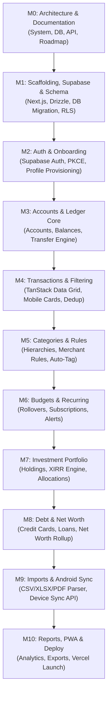

# Development Roadmap & Implementation Milestones

**Project:** WealthOvers — Advanced Personal Money Manager Web Application  
**Execution Strategy:** Sequential, Atomic, Verifiable Milestones  
**Target Architecture:** Next.js 15 App Router + Supabase PostgreSQL + Vercel Serverless  

---

## 1. Roadmap Overview & Phasing

To guarantee stability, data integrity, and strict cross-user security, development is organized into 11 progressive milestones (M0 through M10). Each milestone must pass explicit acceptance criteria and automated verification before advancing.

---

## 2. Detailed Milestone Specifications

### Milestone 0: Architecture, Documentation & Technical Alignment
- **Objective**: Establish foundational technical specifications, architectural diagrams, database schema DDL, RLS policies, and development tracking.
- **Key Deliverables**:
  - `docs/ARCHITECTURE.md`: Complete system architecture, topology, auth flows, Android sync model, Vercel serverless strategy.
  - `docs/DATABASE.md`: 3NF relational schema, ERD diagram, DDL definitions, indexing, triggers, and comprehensive RLS policies.
  - `docs/API_DOCUMENTATION.md`: REST API specifications for `/api/v1/*` with request/response schemas.
  - `docs/DEVELOPMENT_ROADMAP.md`: Sequential milestones and task breakdowns.
  - `DEVELOPMENT_PROGRESS.md`: Project status, tracking matrix, and readiness checklist.
  - `README.md`: Workspace orientation and overview.
- **Acceptance Criteria**: All documents approved by the principal architect and user.

---

### Milestone 1: Project Scaffolding, Supabase Integration & Schema Migration
- **Objective**: Initialize the Next.js 15 application codebase with TypeScript, Tailwind CSS, shadcn/ui primitives, Drizzle ORM, and execute database migrations.
- **Key Tasks**:
  1. Initialize Next.js 15 App Router project with TypeScript and ESLint.
  2. Install and configure Tailwind CSS and install shadcn/ui components (`button`, `input`, `dialog`, `card`, `table`, `tabs`, `dropdown-menu`, `sheet`, `badge`, `tooltip`, `form`).
  3. Set up `@supabase/ssr` and Supabase clients (browser, server, middleware).
  4. Configure Drizzle ORM with Supabase connection pooling string.
  5. Apply database migration executing the complete 24-table schema, check constraints, foreign keys, triggers, and RLS policies on Supabase.
  6. Configure Vitest and React Testing Library.
- **Verification**: Run `npm run typecheck`, verify all 24 tables exist with RLS enabled in Supabase.

---

### Milestone 2: Multi-User Authentication, Onboarding & User Profiles
- **Objective**: Implement robust multi-user authentication, session validation middleware, guided onboarding, and profile provisioning.
- **Key Tasks**:
  1. Build authentication pages: `/login`, `/register`, `/forgot-password`, `/reset-password`, `/verify-email`.
  2. Integrate Supabase Auth email/password signup with email confirmation.
  3. Implement PKCE-based Google OAuth login option.
  4. Implement Next.js edge middleware for session token validation and automatic refresh.
  5. Verify PostgreSQL trigger `handle_new_user()` provisions user profile, default settings (INR / India defaults), and initial categories.
  6. Implement 9-step guided onboarding wizard (`/onboarding`) allowing currency selection, initial bank account setup, and optional budget setup.
- **Verification**: Register test user, verify DB row creation in `profiles`, `user_settings`, and `categories`. Verify session refresh and logout.

---

### Milestone 3: Account Management & Inter-Account Transfers
- **Objective**: Build multi-account management supporting bank accounts, cash, wallets, and credit cards with atomic double-entry transfer logic.
- **Key Tasks**:
  1. Build `/accounts` page featuring grid of account cards showing current balances, masked account numbers, institution badges, and color accents.
  2. Implement Create Account / Edit Account dialogs with account type selector, initial balance, and icon/color customizer.
  3. Implement Inter-Account Transfer modal allowing instant funds transfer between two owned accounts.
  4. Ensure database trigger `sync_account_balance()` atomically debits source account and credits destination account without double-counting expenses.
  5. Implement account archive and delete workflows (preventing deletion of accounts with historical transactions to protect integrity).
- **Verification**: Create 2 accounts, execute transfer of ₹5,000, verify source account drops by ₹5,000 and destination account increases by ₹5,000.

---

### Milestone 4: Transaction Engine, Deduplication & Advanced Filtering
- **Objective**: Build the core transaction ledger with high-performance filtering, pagination, responsive mobile layouts, and deduplication.
- **Key Tasks**:
  1. Build `/transactions` page with desktop TanStack Table and responsive mobile card feed.
  2. Implement Add/Edit Transaction dialog supporting Income, Expense, Transfer, and Refund types with decimal input validation.
  3. Build refund mechanism linking to original transaction and netting against expense reports.
  4. Implement date range filter (Today, This Week, This Month, Last Month, Financial Year, Custom Range).
  5. Implement multi-facet filtering (account, category, type, search term).
  6. Implement deterministic idempotency hashing: `SHA256(user_id + amount + date + account_id + ref_no)` to reject duplicate submissions.
  7. Implement bulk edit and bulk delete operations.
- **Verification**: Unit test `Decimal.js` calculations. Verify mobile layout switches seamlessly from data table to card feed without horizontal overflow.

---

### Milestone 5: Smart Categorization, Subcategories & Merchant Rules
- **Objective**: Implement category management, hierarchical subcategories, merchant directory, and rule-based auto-categorization.
- **Key Tasks**:
  1. Build `/categories` page displaying system and custom categories with icon/color pickers.
  2. Implement subcategory creation and nesting under parent categories.
  3. Build merchant tracking interface with automatic merchant detection from transaction narrations.
  4. Implement deterministic keyword matching rules (`categorization_rules` table) that automatically assign categories to matching narrations (e.g., "Swiggy" -> "Food & Dining").
  5. Allow editing or deleting custom categories without breaking historical transaction records (nullifying foreign keys safely).
- **Verification**: Add rule for "Netflix", create transaction with narration "Netflix Subscription", verify category is automatically populated.

---

### Milestone 6: Budgets, Recurring Transactions & Subscription Manager
- **Objective**: Deliver comprehensive budget tracking with rollover support, recurring transaction scheduling, and subscription renewal alerts.
- **Key Tasks**:
  1. Build `/budgets` page showing category-wise budget progress bars, spending limits, remaining amounts, and utilization percentages.
  2. Implement budget rollover calculation carrying forward surplus or deficit to subsequent periods.
  3. Build `/recurring` page for recurring payments (rent, EMIs, SIPs, utilities) with recurrence frequency options.
  4. Build `/subscriptions` page tracking active SaaS/media subscriptions with next renewal date and cancellation notice warnings.
  5. Implement visual overspending alerts (visual badges when budget exceeds 85% and 100%).
- **Verification**: Verify budget utilization calculations; simulate rollover from Month M to Month M+1.

---

### Milestone 7: Investment Portfolio Engine & Returns Analytics
- **Objective**: Build investment tracking for Indian stocks, US stocks, mutual funds, ETFs, gold, and crypto with XIRR and asset allocation.
- **Key Tasks**:
  1. Build `/investments` dashboard displaying total invested, current valuation, unrealized gain/loss, and overall return.
  2. Implement portfolio holdings table grouped by asset class (Equity, Mutual Funds, Gold, Fixed Income, Crypto).
  3. Implement buy, sell, and dividend transaction logger for investments.
  4. Implement Newton-Raphson XIRR calculation engine in TypeScript with iteration limits and fallback to Absolute Return.
  5. Integrate public free NAV tracking for Indian Mutual Funds (via AMFI open data) with stale-data labeling.
  6. Support USD-to-INR currency conversion for US stocks.
- **Verification**: Run Vitest test cases with known cash flows to verify XIRR precision against standard financial benchmarks.

---

### Milestone 8: Credit Cards, Loans, Liabilities & Net Worth Analytics
- **Objective**: Implement credit card billing cycles, loan amortization tracking, fixed asset valuations, and real-time Net Worth rollups.
- **Key Tasks**:
  1. Build `/credit-cards` page with visual card representations, credit limit, available credit, statement dates, and payment due alerts.
  2. Ensure credit card bill settlement is accounted for as a transfer, preventing double expense counting.
  3. Build `/loans` page with EMI breakdown (principal vs interest component) and loan amortization progress.
  4. Build `/net-worth` dashboard showing live rollup:
     $$\text{Net Worth} = \text{Total Assets} - \text{Total Liabilities}$$
  5. Render historical net worth growth curve and asset allocation pie chart using Recharts.
- **Verification**: Verify that credit card purchases count as expenses when made, while bill payments reduce debt without altering net expenses.

---

### Milestone 9: Statement Import Pipeline & Android Sync Gateway
- **Objective**: Implement bank statement parsing (CSV, XLSX, PDF) and the Android companion device synchronization API gateway.
- **Key Tasks**:
  1. Build `/import` page with file dropzone supporting CSV, XLSX, and PDF files.
  2. Implement client-side parser using PapaParse (CSV) and SheetJS (XLSX).
  3. Implement interactive column mapping wizard with Indian bank presets (HDFC, SBI, ICICI, Axis).
  4. Implement duplicate detection preview before committing imported rows.
  5. Build Android companion device pairing interface (`/devices`) with QR code pairing and device revocation.
  6. Implement `/api/v1/transactions/sync` endpoint with device token authentication, idempotency filtering, and review staging queue.
- **Verification**: Upload sample bank statement CSV; verify duplicate detection prevents importing duplicate rows. Test device sync API with mock payload.

---

### Milestone 10: Advanced Reports, PWA Hardening & Vercel Production Deployment
- **Objective**: Build analytical reporting, data export, PWA manifest, execute full test suite, and deploy to Vercel.
- **Key Tasks**:
  1. Build `/reports` page featuring Cash Flow Sankey/Bar charts, Income vs Expense comparisons, and Category breakdowns.
  2. Implement CSV and XLSX financial data export.
  3. Configure PWA manifest (`manifest.json`), icons, and service worker for offline application shell.
  4. Implement global privacy mode toggle (masking currency figures with `••••••`).
  5. Perform comprehensive responsive layout audit across 320px, 375px, 768px, 1024px, 1440px viewports; eliminate horizontal overflow.
  6. Run automated test suite: `npm run lint`, `npm run typecheck`, `npm run test`, `npm run build`.
  7. Prepare `.env.example`, Supabase production instructions, and deploy to Vercel.
- **Verification**: Verify successful production build on Vercel with zero runtime errors. Verify RLS cross-user isolation.

