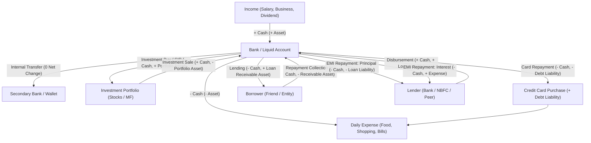

# WealthOvers — Financial Workflow & Money Movement Map

**Financial Systems Engineering Team:** Agent 5 (Financial Accounting Specialist) & Agent 6 (Transaction Specialist)  
**Reviewed by:** Agent 1 (Principal Architect)  
**Engine:** Decimal.js (28-digit precision) / `FinancialTransactionService`

---

## 1. Global Balance Sheet Equation

WealthOvers enforces standard international accounting principles:

$$\text{Net Worth} = \sum \text{Total Assets} - \sum \text{Total Liabilities}$$

### Asset Components:
* **Liquid Assets:** Sum of balances across all non-archived Bank, Savings, Current, Cash, and Wallet accounts.
* **Investment Assets:** Real-time valuation of Stocks, Mutual Funds, ETFs, Crypto, Gold, and Fixed Deposits.
* **Loan Receivables:** Capital lent to external parties (`loan_given`).
* **Fixed & Tangible Assets:** Real estate, vehicles, valuables, and physical capital.

### Liability Components:
* **Credit Card Liabilities:** Current outstanding revolving card debt across all active credit cards.
* **Loan Liabilities:** Outstanding principal balances on Mortgages, Personal Loans, Vehicle Financing, and Borrowed Debt.
* **Manual External Liabilities:** Structured personal debts or private accounts payable.

---

## 2. Comprehensive Financial Workflow Map

---

## 3. Financial Invariant Proofs

### A. Internal Transfer Invariant
$$\Delta \text{Assets}_{\text{Source}} = -X, \quad \Delta \text{Assets}_{\text{Destination}} = +X$$
$$\Delta \text{Net Worth} = (-X + X) - 0 \equiv 0$$
*Rule:* Transfers never alter income, expenses, or net worth.

### B. Credit Card Lifecycle Invariant
1. **On Purchase ($X$):**
   $$\Delta \text{Expense} = +X, \quad \Delta \text{Liabilities} = +X \implies \Delta \text{Net Worth} = -X$$
   *Bank cash is untouched.*
2. **On Settlement / Repayment ($X$):**
   $$\Delta \text{Assets}_{\text{Bank}} = -X, \quad \Delta \text{Liabilities}_{\text{Card}} = -X$$
   $$\Delta \text{Net Worth} = (-X) - (-X) \equiv 0$$
   *No second expense is recorded.*

### C. Loan Disbursement & Amortized EMI Invariant
1. **On Disbursement ($D$):**
   $$\Delta \text{Assets}_{\text{Bank}} = +D, \quad \Delta \text{Liabilities}_{\text{Loan}} = +D \implies \Delta \text{Net Worth} \equiv 0$$
2. **On Monthly EMI Payment ($E = P_{\text{principal}} + I_{\text{interest}}$):**
   $$\Delta \text{Assets}_{\text{Bank}} = -E$$
   $$\Delta \text{Liabilities}_{\text{Loan}} = -P_{\text{principal}}$$
   $$\Delta \text{Expense}_{\text{Interest}} = +I_{\text{interest}}$$
   $$\Delta \text{Net Worth} = -E - (-P) = -(P + I) + P = -I_{\text{interest}}$$
   *Only the interest expense reduces net worth; principal reduction pays down debt liability.*

### D. Systematic Investment Plan (SIP) Invariant
$$\Delta \text{Assets}_{\text{Bank}} = -S, \quad \Delta \text{Assets}_{\text{Holding}} = +S$$
$$\Delta \text{Net Worth} = (-S + S) - 0 \equiv 0$$
$$\text{New Holding Quantity} = Q_{\text{old}} + \frac{S}{\text{Execution NAV}}$$
*Rule:* SIP deductions are recorded as Outflows from bank cash while capital moves into portfolio assets.

---

## 4. Safe-to-Spend Daily Velocity Algorithm

The Safe-to-Spend algorithm ensures users never overspend before their billing cycles or budget periods conclude:

$$\text{Remaining Safe Pool} = \max\left(0, \text{Remaining Budget} - \sum \text{Upcoming Unpaid Bills}\right)$$

$$\text{Safe-to-Spend Today} = \frac{\text{Remaining Safe Pool}}{\max(1, \text{Days Remaining in Cycle})}$$

If no explicit budget is set:
$$\text{Remaining Safe Pool} = \max\left(0, \text{Liquid Cash} - \sum \text{Credit Card Dues} - \sum \text{Upcoming Bills}\right)$$

