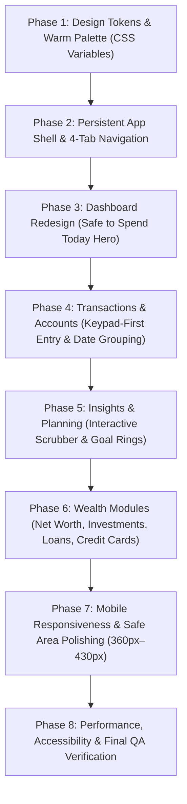

# WealthOvers — UI/UX Redesign Implementation Plan (Leftovers Philosophy)

**Engineering Objective**: Redesign WealthOvers using the calm, warm, minimal design language of Leftovers while preserving all advanced wealth management engines, mathematical precision, database records, and Supabase RLS security.

---

## 1. Project Principles & Guardrails

1. **Do Not Rebuild From Scratch**: Enhance and restyle the existing production-ready Next.js 15 App Router codebase.
2. **Preserve All Financial Logic**: Maintain 100% of Decimal.js 28-digit precision, XIRR calculations, loan amortization, transfer exclusions, and Indian FY logic.
3. **Preserve User Data & RLS**: All Supabase migrations, Row Level Security policies, user profiles, and companion device tokens remain untouched.
4. **Maintain Fast Navigation**: Keep the persistent application shell, route-level `loading.tsx` skeletons, request-memoized auth (`getAuthenticatedUser()`), and dynamic modal imports.

---

## 2. Eight-Phase Execution Roadmap

---

### Phase 1: Design Tokens & Theme System
**Objective**: Transition the global styling system from cold navy/indigo to the Leftovers-inspired warm ivory and forest green palette.
- **Deliverables**:
  - Update `app/globals.css` with CSS variables for Light (`#F7F7F0` canvas, `#244B3C` forest green, `#E9EEE5` soft sage, `#292F2B` charcoal text) and Dark (`#151C18` canvas, `#1D2821` card, `#9BB99D` sage primary, `#EFF3EA` text).
  - Update semantic tokens for success (`#39805B`), danger/expenses (`#C77A65`), and warnings (`#C39148`).
  - Configure `tailwind.config.ts` if needed to map `--surface-secondary`, `--primary-soft`, and custom radii.
  - Refactor `components/theme-provider.tsx` and theme toggle to support Light, Dark, and System modes seamlessly.
- **Verification**: Run `npm run build && npm test` to ensure zero compilation or styling syntax regressions.

---

### Phase 2: Shared Application Layout & Navigation
**Objective**: Build a clean, quiet desktop sidebar and the Leftovers 4-tab mobile navigation bar with an elevated action trigger.
- **Deliverables**:
  - **Desktop Sidebar (`app-sidebar.tsx`)**:
    - Slim, elegant left rail with brand identity, active pill indicator, and collapsible state.
    - Organize 13 sections into logical tiers:
      - *Core Daily*: Home (`/dashboard`), Activity (`/transactions`), Insights (`/reports`), Plan (`/budgets`)
      - *Balance Sheet & Wealth*: Net Worth (`/net-worth`), Accounts (`/accounts`), Investments (`/investments`), Credit Cards (`/credit-cards`), Loans (`/loans`), Assets (`/assets`)
      - *System*: Automation (`/devices`), Settings (`/settings`)
  - **Mobile Bottom Navigation (`mobile-nav.tsx`)**:
    - Four primary destinations: **Home**, **Activity**, **Insights**, **Plan**.
    - Central elevated **+ Add Transaction** button with haptic press feel.
    - Integrated **More** drawer providing 1-tap access to Net Worth, Investments, Loans, Credit Cards, Assets, and Settings.
  - **Desktop Header (`app-header.tsx`)**:
    - Warm, minimal breadcrumb header with global search trigger (`⌘K`), privacy mask toggle, notifications, and profile menu.
- **Verification**: Verify that navigating between all routes maintains the persistent layout shell with zero unmounting or screen flicker.

---

### Phase 3: Dashboard Redesign ("Safe to Spend Today")
**Objective**: Restructure the home dashboard around the central question: *"How much money do I have, and how much can I safely spend today?"*
- **Deliverables**:
  - **Hero Module: Safe to Spend Today**:
    - Implement the dynamic safe-to-spend calculation in `lib/calculations/financial.ts`:
      $$\text{Daily Safe Spend} = \frac{\text{Remaining Budget} - \text{Committed Bills Due}}{\text{Days Remaining in Cycle}}$$
    - Continuous progress meter: spent vs. remaining budget with days remaining indicator.
    - Fallback estimate banner if no budget is configured.
  - **Account Balances Strip**:
    - Display all liquid accounts (bank accounts, cash, digital wallets) with current balances and quick transfer trigger.
  - **Recent Activity Feed**:
    - Latest 5 transactions with clear merchant name, category pill, account, and amount.
  - **Upcoming Payments**:
    - Scheduled EMIs, credit card statements, and subscriptions due within the next 14–30 days with due date alerts.
  - **Financial Overview**:
    - High-level net worth, total assets, total liabilities, and savings rate summarized cleanly without visual clutter.
- **Verification**: Test with zero accounts, partial data, and full data to ensure robust handling of all financial states.

---

### Phase 4: Transaction & Accounts Experience
**Objective**: Create a keypad-first, rapid transaction logging workflow and a date-grouped transaction timeline.
- **Deliverables**:
  - **Keypad-First Quick Transaction Modal (`create-transaction-dialog.tsx`)**:
    - Large tactile numeric keypad ($1$–$9$, `.`, $0$, $\backspace$) with instant amount formatting.
    - 1-tap segment selector: **Expense** / **Income** / **Transfer**.
    - Category pills and account selectors with smart defaults.
    - Expandable optional fields: notes, split with friend/category, and transaction date.
  - **Date-Grouped Transaction Ledger (`transaction-ledger.tsx`)**:
    - Group transactions by calendar day with date headers (`"Today, 2 Nov"`, `"Yesterday"`, etc.) and daily subtotal sums.
    - Retain non-blocking search via `useDeferredValue` and 25-item page slicing.
  - **Accounts View (`account-grid.tsx`)**:
    - Clean sage-toned account cards showing institution, account type, liquid balance, and statement reconciliation status.
- **Verification**: Test keyboard input, touch keypad clicks, transfer workflow, and split transactions across multiple categories.

---

### Phase 5: Insights & Planning Modules
**Objective**: Build Leftovers-inspired interactive spending analysis and visual goal progress.
- **Deliverables**:
  - **Interactive Month Scrubber (`reports-view.tsx` / `insights-view`)**:
    - Tactile 30/31-day bar visualization allowing users to hover or scrub across days to inspect exact outflows.
    - Real-time display of *Month-to-date total*, *Daily average burn*, and *Largest expense day*.
  - **Income vs. Expense & Category Mix**:
    - Simplified, elegant visual breakdowns using custom soft sage and coral tones.
  - **Planning & Goals Hub (`budgets/page.tsx` & `goals/page.tsx`)**:
    - Monthly budget envelope progress bars.
    - SVG Goal Progress Rings showing percentage achieved, remaining corpus gap, and monthly savings recommendation.
    - Upcoming bills and subscription schedule.
- **Verification**: Check interactive scrubbing on touch and mouse, verify goal trajectory formulas, and ensure correct percentage calculations.

---

### Phase 6: Wealth Management Modules Harmonization
**Objective**: Apply the calm, warm design language to all advanced wealth modules without losing any analytic power.
- **Deliverables**:
  - **Net Worth View (`net-worth-view.tsx`)**:
    - Clean asset allocation breakdown and historical net worth timeline.
  - **Investments View (`investment-portfolio-view.tsx`)**:
    - Holdings list, asset classification (Mutual Funds, Equities, Gold, Fixed Deposits), unrealized P&L, and XIRR display.
  - **Credit Cards View (`credit-card-view.tsx`)**:
    - Card limit utilization bars, statement due dates, minimum amount due alerts, and one-click payment logging.
  - **Loans & Liabilities View (`loan-view.tsx`)**:
    - Outstanding principal, monthly EMI obligations, and dynamic amortization modal.
  - **Assets & Liabilities View (`assets-liabilities-view.tsx`)**:
    - Physical assets (real estate, vehicles, gold) vs. external liabilities and net tangible capital.
- **Verification**: Verify all calculations reconcile with balance sheet formulas and tests.

---

### Phase 7: Mobile Responsiveness & Touch Optimization
**Objective**: Ensure the entire application renders flawlessly across all mobile viewport sizes.
- **Deliverables**:
  - Test at `360px` (small mobile), `390px` (iPhone standard), `430px` (iPhone Pro Max / modern Android), and tablets (`768px`).
  - Zero horizontal overflow (`overflow-x: hidden`).
  - Touch target sizing $\ge 44\text{px} \times 44\text{px}$ for all interactive buttons and keypad digits.
  - Safe-area inset padding (`pb-safe`) for iOS Safari and Android bottom gestures.
- **Verification**: Validate layouts in browser responsive preview and verify no horizontal scrollbars appear.

---

### Phase 8: Performance, Accessibility & Final Sign-Off
**Objective**: Benchmark performance and ensure complete WCAG 2.1 AA accessibility.
- **Deliverables**:
  - Execute full test suite: `npm run typecheck && npm run lint && npm test`.
  - Compile production build: `npm run build`.
  - Validate Core Web Vitals: LCP $\le$ 2.0s, INP $\le$ 150ms, CLS $\le$ 0.02.
  - Confirm WCAG 2.1 AA color contrast ratios across both light and dark themes.
  - Update `DEVELOPMENT_PROGRESS.md` and commit final release.
- **Verification**: 100% green tests, 0 TypeScript errors, 0 ESLint warnings, production build exit code 0.
