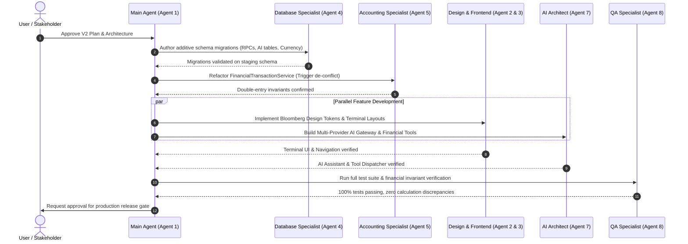

# WEALTHOVERS V2 — MULTI-AGENT ORCHESTRATION & OWNERSHIP MATRIX

**Lead Agent:** Main Agent / Principal Architect  
**Project:** WealthOvers V2  
**Status:** Approved for Orchestration  

---

## 1. Multi-Agent Governance & Operating Rules

To prevent merge conflicts, regression loops, and architectural drift, all work across WealthOvers V2 follows these strict rules:

1. **Clear Scope & Single Ownership:** Every module and file has exactly one designated primary owner at any given time.
2. **Sequential Database & Accounting Gates:** Shared database migrations (`supabase/migrations/`) and double-entry ledger logic (`FinancialTransactionService`) must be finalized and peer-reviewed before dependent UI or AI features are merged.
3. **Strict Peer Review for Math & Security:** Any modification affecting monetary arithmetic (`Decimal.js`), authentication (`middleware.ts`, `lib/supabase/`), or RLS policies requires peer review by the Principal Architect and QA Specialist.
4. **Parallel Execution for Independent Domains:** UI layout development (Agent 2/3), AI gateway integration (Agent 7), and documentation updates can proceed in parallel once foundational types and contracts are frozen.
5. **Verified Multi-Agent Execution:** The Main Agent orchestrates all specialist actions and integrates all deliverables into the main workspace.

---

## 2. Specialist Agent Roles, Scopes & Deliverables

### Agent 1 — Principal Architect
* **Primary Scope:** Overall system architecture, design integrity, agent coordination, and cross-phase release signoff.
* **Key Deliverables:**
  - `docs/V2/V1_AUDIT.md`
  - `docs/V2/V2_ARCHITECTURE.md`
  - `docs/V2/IMPLEMENTATION_ROADMAP.md`
  - `docs/V2/RISK_REGISTER.md`
  - Integration of all PRs and final gate validation.
* **File Ownership:** `docs/V2/*`, `next.config.ts`, `tsconfig.json`, `package.json`

### Agent 2 — UI/UX Design Specialist
* **Primary Scope:** Bloomberg terminal aesthetic, visual density, design tokens, typography, and responsive component primitives.
* **Key Deliverables:**
  - `docs/V2/DESIGN_SYSTEM.md`
  - Terminal color tokens in `app/globals.css` (Dark: `--app-bg: #101820`, Light: `--app-bg: #F3F5F7`).
  - Terminal component library: KPI cards, tabular data tables, ticker bar, drawers, modal shells.
  - Desktop collapsible sidebar and mobile bottom navigation.
* **File Ownership:** `app/globals.css`, `tailwind.config.ts`, `components/ui/*`, `components/layout/*`

### Agent 3 — Frontend Engineering Specialist
* **Primary Scope:** App Router page implementation, client state management, interactive dashboards, and view components.
* **Key Deliverables:**
  - High-density Bloomberg Command Centre (`app/(dashboard)/dashboard/page.tsx` & `components/dashboard/*`).
  - High-density Transaction grid with keyboard shortcuts (`components/transactions/*`).
  - Account cards with inline running balance triggers (`components/accounts/*`).
  - Dedicated Subscriptions view (`app/(dashboard)/subscriptions/page.tsx`).
* **File Ownership:** `app/(dashboard)/*`, `components/transactions/*`, `components/accounts/*`, `components/dashboard/*`

### Agent 4 — Database and Supabase Specialist
* **Primary Scope:** PostgreSQL schema management, migration scripts, indexes, RLS policies, and PostgREST RPC optimization.
* **Key Deliverables:**
  - `docs/V2/DATABASE_COMPATIBILITY.md`
  - `supabase/migrations/20261107000000_android_sync_rpc.sql` (Restore missing RPC)
  - `supabase/migrations/20261107010000_v2_dashboard_summary_rpc.sql` (Harmonize complete net worth)
  - `supabase/migrations/20261107020000_ai_assistant_tables.sql` (Conversations & messages)
  - `supabase/migrations/20261107030000_currency_rates.sql` (Dynamic exchange rates)
  - `supabase/migrations/20261107040000_harmonize_account_balance_triggers.sql` (Trigger de-conflict)
* **File Ownership:** `supabase/migrations/*`, `types/database.ts`

### Agent 5 — Financial Accounting Specialist
* **Primary Scope:** Double-entry journal postings, transaction engine invariants, Decimal.js calculations, and audit history.
* **Key Deliverables:**
  - Authoritative balance management in `lib/services/financial-transaction-service.ts`.
  - Reversal and contra-entry accounting verification.
  - Split transaction allocation invariants.
  - Transfer neutrality verification (zero net cash flow impact).
* **File Ownership:** `lib/services/financial-transaction-service.ts`, `lib/calculations/financial.ts` (accounting sections)

### Agent 6 — Wealth Management Specialist
* **Primary Scope:** Net worth calculation, investment portfolio valuation, loan amortization, credit card cycles, and asset depreciation.
* **Key Deliverables:**
  - Multi-asset categorization (Indian Stocks, US Stocks, Mutual Funds, ETFs, Gold) in `components/investments/*`.
  - Dynamic currency conversion via exchange rates table.
  - Loan step-up and foreclosure simulation models.
  - Credit card unbilled vs billed transaction cycle calculator.
* **File Ownership:** `components/investments/*`, `components/loans/*`, `components/credit-cards/*`, `components/assets/*`

### Agent 7 — AI Architect
* **Primary Scope:** Cloud AI Gateway, multi-provider LLM integration, secure tool calling, and conversational financial analysis.
* **Key Deliverables:**
  - Provider-agnostic gateway in `lib/ai/gateway.ts` (Gemini, Claude, OpenAI).
  - Server-side API route `/api/ai/chat/route.ts`.
  - Read-only financial tools: `getSpendingAnalysis`, `getPortfolioBreakdown`, `getNetWorthHistory`, `forecastCashFlow`.
  - PII redaction and financial safety guardrails.
  - Interactive terminal chat component `components/ai/ai-finance-assistant.tsx`.
* **File Ownership:** `lib/ai/*`, `app/api/ai/*`, `components/ai/*`

### Agent 8 — QA and Testing Specialist
* **Primary Scope:** Automated testing, Vitest test suites, financial invariant checks, RLS security tests, and regression benchmarking.
* **Key Deliverables:**
  - `docs/V2/TEST_STRATEGY.md`
  - Financial invariant test suite covering all 12 core transaction workflows.
  - Double-entry debit = credit assertion suites.
  - RLS multi-tenant boundary tests.
  - Concurrency resilience and benchmark calibration.
* **File Ownership:** `tests/*`, `vitest.config.ts`

### Agent 9 — Performance Specialist
* **Primary Scope:** Next.js rendering optimization, bundle tree-shaking, streaming SSR, query caching, and mobile responsiveness.
* **Key Deliverables:**
  - Server component parallelization in `Promise.all` across all dashboard routes.
  - Dynamic imports (`next/dynamic`) for heavy charting libraries.
  - Keyset pagination for large transaction datasets.
  - Zero-layout-shift terminal UI on mobile and tablet.
* **File Ownership:** `lib/data/cached-queries.ts`, `next.config.ts` (bundle optimization)

### Agent 10 — Deployment and Security Specialist
* **Primary Scope:** Staging/Production environments, Vercel configuration, Content Security Policy, secret management, and backup plans.
* **Key Deliverables:**
  - `vercel.json` deployment tuning.
  - Edge middleware route whitelist update in `lib/supabase/middleware.ts`.
  - Zero-trust token authentication verification for Android companion API.
  - Automated CI/CD pipeline verification (`.github/workflows/ci.yml`).
* **File Ownership:** `middleware.ts`, `lib/supabase/middleware.ts`, `vercel.json`, `.github/workflows/*`

---

## 3. Conflict Prevention Matrix & Execution Sequences

Proceed to **`IMPLEMENTATION_ROADMAP.md`** for phase-by-phase delivery plans.

