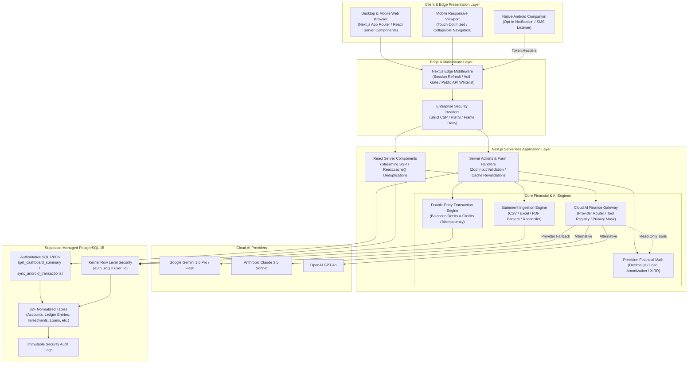
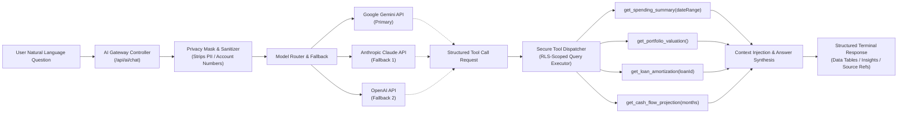

# WEALTHOVERS V2 — SYSTEM ARCHITECTURE SPECIFICATION

**Product:** WealthOvers V2 (Personal Wealth Operating System)  
**Architect:** Principal Software Architect & Lead Financial Systems Engineer  
**Status:** Approved for Implementation  
**Target Environment:** Next.js 15.5+ (Vercel Serverless / Edge), Supabase PostgreSQL 15, Cloud AI Multi-Provider Gateway  

---

## 1. Architectural Vision & Design Philosophy

WealthOvers V2 redefines personal wealth intelligence by combining the rigor, speed, and informational density of institutional financial terminals (Bloomberg, FactSet) with an intuitive, mobile-responsive consumer experience.

### Core Architecture Tenets
1. **Financial Absolute Truth:** Every account balance, net worth figure, and cash-flow metric is derived directly from immutable, double-entry ledger transactions with 28-digit `Decimal.js` precision. Zero simulated data, zero hardcoded values, and zero floating-point approximation.
2. **Bloomberg Terminal Density:** UI layouts prioritize high data-ink ratios, tabular mono-spaced numerical figures, clear visual hierarchy, keyboard navigability, and real-time telemetry over decorative whitespace and cosmetic animations.
3. **Provider-Independent Cloud AI Gateway:** An isolated server-side AI proxy routes natural language financial questions to supported LLMs (Gemini, Claude, OpenAI). The LLM is granted **read-only, deterministic tool execution** with zero access to arbitrary SQL and zero autonomous mutation capabilities.
4. **Zero-Trust Ingestion:** Bank sync and device notifications undergo local regex sanitization on Android, transmission over authenticated SHA-256 token APIs, and idempotent database insertion with duplicate hashing.
5. **Strict Multi-Tenant Isolation:** Supabase Row Level Security (RLS) operates as an unbypassable kernel-level firewall, preventing cross-user data leakage even if application-level bugs occur.

---

## 2. High-Level System Architecture



---

## 3. Regional Defaults & Localization Standards

WealthOvers V2 defaults to the Indian financial ecosystem while preserving clean multi-currency capabilities for global investment holdings:

| Parameter | Standard Default | Fallback / Options | Architectural Handling |
| :--- | :--- | :--- | :--- |
| **Primary Currency** | `INR` (`₹`) | `USD` (`$`), `EUR` (`€`), `GBP` (`£`) | ISO-4217 3-letter codes; converted via dynamic `currency_exchange_rates` table. |
| **Timezone** | `Asia/Kolkata` (`UTC+05:30`) | User-configured in `user_settings` | Timestamps stored in UTC (`TIMESTAMPTZ`); formatted client-side in user timezone. |
| **Financial Year** | `April 1 – March 31` | Calendar Year (`Jan 1 – Dec 31`) | Defined by `financial_year_start_month` (default `4`); dynamic date slicers in `date-ranges.ts`. |
| **Number Formatting** | Indian System (`₹ 1,23,456.78`) | International (`123,456.78`) | `Intl.NumberFormat("en-IN", { style: "currency", currency: "INR" })` with tabular numerals. |
| **Language** | English (`en-IN`) | Extensible i18n structure | All system strings defined in typed constants. |

---

## 4. Subsystem Breakdown

### 4.1 Application Navigation Structure
The user interface adheres to a 10-module hierarchy organized by operational domain:

```
COMMAND CENTRE
├── Dashboard (/dashboard)          -> Real-time net worth, cash flow ticker, safe-to-spend, widgets
└── Net Worth (/net-worth)          -> Complete asset vs liability breakdown, historical trajectory

TRANSACTIONS
├── All Transactions (/transactions)-> Double-entry ledger, running balances, advanced filters
├── Accounts (/accounts)            -> Bank accounts, cash wallets, cards, running balance audit
├── Transfers (/transfers)          -> Capital movement between liquid accounts (net-zero cash impact)
├── Reconciliation (/reconcile)     -> Bank balance vs ledger verification and discrepancy adjustments
└── Import Statements (/import)     -> Multi-format parser (CSV, Excel, PDF) with duplicate detection

PLANNING
├── Budgets (/budgets)              -> Envelope budgeting, category caps, rollover mechanisms
├── Recurring Bills (/recurring)    -> Contractual obligations, autopay status, due calendars
├── Subscriptions (/subscriptions)  -> SaaS and service tracker with cadence and cost-per-use
├── Financial Goals (/goals)        -> Target milestones, automated progress projection, earmarks
└── Financial Calendar (/calendar)  -> Aggregated timeline: EMIs, SIPs, credit card dues, bills

INVESTMENTS
├── Portfolio (/investments)        -> Consolidated net equity, asset allocation, realized/unrealized P&L
├── Indian Stocks (/investments/in) -> NSE/BSE equity holdings, trade book, sector distribution
├── US Stocks (/investments/us)     -> Foreign equity, exchange rate conversion, capital gains
├── Mutual Funds (/investments/mf)  -> Fund holdings, NAV tracking, SIP automated schedules
├── ETFs & Commodities              -> Gold, Silver, Index funds, Sovereign Gold Bonds (SGB)
├── Dividends (/investments/yield)  -> Income yield tracking, broker-wise payout audit
└── Performance (/investments/perf) -> XIRR, CAGR, benchmark comparison (Nifty 50, S&P 500)

CREDIT AND DEBT
├── Credit Cards (/credit-cards)    -> Revolving limits, unbilled amounts, payment cycles, APR
├── Loans (/loans)                  -> Home, auto, personal loans with amortization schedules
├── External Liabilities (/assets)  -> Family debts, promissory notes, informal commitments
├── EMI Planner (/loans/planner)    -> Step-up calculator, prepayment vs SIP simulation
└── Debt Payoff Planner (/debt-free)-> Snowball and Avalanche payoff trajectory models

ASSETS
├── Property & Land (/assets/real)  -> Physical real estate, linked mortgages, appreciation tracking
├── Vehicles (/assets/vehicles)     -> Automobiles, bikes, depreciation schedules
├── Gold & Jewellery (/assets/gold) -> Physical precious metals, hallmark verification, bullion weight
├── Other Assets (/assets/misc)     -> Art, electronics, private equity, business equity
└── Valuation History (/assets/log) -> Historical revaluation ledger with unrealized gain/loss tracking

INTELLIGENCE
├── AI Finance Assistant (/ai/chat) -> Cloud AI conversational analyst with structured tool access
├── Financial Insights (/insights)  -> Spending anomalies, burn rate analysis, runway estimation
├── Cash Flow Forecast (/forecast)  -> 3-month predictive cash position based on recurring rules & trends
└── Financial Scenarios (/scenarios)-> What-if simulations (job change, home purchase, market drawdown)

REPORTS
├── Personal Balance Sheet          -> Formal assets minus liabilities statement
├── Income Statement (P&L)          -> Inflows minus operating expenditures across custom periods
├── Cash Flow Statement             -> Operating, investing, and financing cash flows
├── Tax & Fiscal Year Summary       -> Indian tax-deductible items (80C, 80D), capital gains breakdown
└── Statement Exports               -> Standardized CSV, Excel (.xlsx), and PDF reports

AUTOMATION
├── Android Sync (/devices)         -> Device pairing, cryptographic tokens, ingestion status
├── Transaction Rules (/rules)      -> Merchant regex mapping, auto-categorization criteria
└── Notification Hub                -> Bill reminders, budget threshold alerts, anomaly warnings

SETTINGS
├── Profile & Security (/profile)   -> Authentication, password update, active sessions
├── Preferences (/settings)         -> Currency, timezone, financial year, privacy mask toggle
├── Appearance (/settings/theme)    -> Dark terminal (default), Light terminal, System sync
└── AI Gateway Settings (/settings/ai) -> Model selection, privacy redaction level, API preferences
```

---

## 5. Double-Entry Accounting Architecture

### 5.1 Accounting Invariant
Every transaction posted to WealthOvers V2 must satisfy the fundamental double-entry identity:
$$\sum \text{Debits} - \sum \text{Credits} = 0$$

### 5.2 Transaction Journal Matrix

| Transaction Type | Debit (Asset $\uparrow$ / Expense $\uparrow$ / Liability $\downarrow$) | Credit (Asset $\downarrow$ / Income $\uparrow$ / Liability $\uparrow$) | Net Worth Impact |
| :--- | :--- | :--- | :--- |
| **Salary / Income** | Bank Account (Asset $\uparrow$) | Income Category (Income $\uparrow$) | $+ \text{Amount}$ |
| **Expense** | Expense Category (Expense $\uparrow$) | Bank Account (Asset $\downarrow$) | $- \text{Amount}$ |
| **Account Transfer** | Destination Bank (Asset $\uparrow$) | Source Bank (Asset $\downarrow$) | $0$ (Neutral) |
| **Credit Card Purchase** | Expense Category (Expense $\uparrow$) | Credit Card (Liability $\uparrow$) | $- \text{Amount}$ |
| **Credit Card Repayment**| Credit Card (Liability $\downarrow$) | Bank Account (Asset $\downarrow$) | $0$ (Net Worth Preserved) |
| **Loan Disbursement** | Bank Account (Asset $\uparrow$) | Loan Payable (Liability $\uparrow$) | $0$ (Cash matched by debt) |
| **Loan EMI Payment** | Loan Principal (Liability $\downarrow$) + Interest Expense (Expense $\uparrow$) | Bank Account (Asset $\downarrow$) | $- \text{Interest Portion}$ |
| **Investment Purchase** | Demat Portfolio (Asset $\uparrow$) | Bank Account (Asset $\downarrow$) | $0$ (Asset swap) |
| **Asset Purchase** | Fixed Asset (Asset $\uparrow$) | Bank Account (Asset $\downarrow$) | $0$ (Asset swap) |
| **Asset Revaluation** | Fixed Asset Adjustment (Asset $\Delta$) | Unrealized Revaluation Equity | $\Delta \text{Valuation}$ |
| **Transaction Reversal**| Original Credit Entity (Debit) | Original Debit Entity (Credit) | Exactly negates original |

### 5.3 Unified Ledger Service (`FinancialTransactionService`)
- Operates as the **sole authority** for creating, modifying, reversing, and deleting financial transactions.
- Writes to `public.transactions` and generates corresponding balanced rows in `public.ledger_entries`.
- Enforces an idempotency hash (`SHA-256(user_id, amount, date, ref, merchant)`) preventing accidental duplicate submissions.
- Directly updates entity balances atomically within a single transaction boundary, bypassing obsolete conflicting triggers.

---

## 6. Cloud AI Finance Assistant Architecture

### 6.1 Provider-Independent Architecture
The AI Finance Assistant is decoupled from any proprietary model vendor using a standardized internal gateway interface:



### 6.2 Strict AI Safety Boundaries
1. **Zero Arbitrary SQL:** The LLM cannot execute raw SQL or construct query fragments. All database interactions are routed through predefined, strictly validated TypeScript service functions.
2. **Read-Only Inspection:** The AI assistant is strictly read-only. It cannot create transactions, modify balances, delete accounts, or alter budgets without explicit, manual, user-confirmed UI actions.
3. **Deterministic Financial Math:** Calculations (such as total spending, net worth changes, or loan interest) are computed in TypeScript using `Decimal.js` and returned to the LLM via tool outputs. The LLM is never allowed to hallucinate or guess financial sums.
4. **Data Redaction & Privacy:** Masked account numbers (e.g. `****4321`), user full names, and sensitive credentials are encrypted or omitted from LLM prompts.

---

## 7. Data Ingestion & Android Automation Architecture

### 7.1 Security & Authentication Architecture
1. **Pairing Handshake:**
   - The user clicks "Pair Device" on the web dashboard.
   - The web app generates a secure 64-character token (`wov_dev_<hex>`), displays it once, and hashes it (`SHA-256`) into `public.devices.token_hash`.
2. **Device Authentication:**
   - The Android client sends requests with `X-Device-Id` and `X-Device-Token` headers.
   - Next.js edge middleware permits `/api/v1/` routes to pass without session cookies.
   - The API endpoint verifies the token hash against `public.devices` via the secure RPC `sync_android_transactions`.
3. **Zero-Trust OTP Filter:**
   - Client and server inspect incoming records with regex `/\b(otp|verification code|secret pin)\b/i`.
   - Matching payloads are immediately dropped with security violation codes.
4. **Idempotency Protection:**
   - The Android client or API hashes each transaction metadata. Existing hashes in `public.transactions.idempotency_hash` are ignored to prevent duplicate charges upon network retry.

---

## 8. Security & Compliance Architecture

1. **Row Level Security (RLS):** All tables enforce `USING (auth.uid() = user_id) WITH CHECK (auth.uid() = user_id)`. Service role keys are restricted to maintenance scripts and strictly barred from web runtimes.
2. **Content Security Policy (CSP):** Enforced in `next.config.ts` with `default-src 'self'`, `frame-ancestors 'none'`, and restricted Supabase API endpoints.
3. **Session Management:** Auth tokens managed via `@supabase/ssr` HTTP-only, secure, SameSite cookies. `React.cache()` memoizes authenticated user lookups per request.
4. **Rate Limiting:** Edge API endpoints (`/api/v1/*`, `/api/ai/*`) are protected by IP and device token rate limiting to thwart brute-force and DDoS attempts.

---

## 9. Performance & Scalability Targets

| Metric | Target Specification | Enforcement Mechanism |
| :--- | :--- | :--- |
| **SSR First Load JS** | $< 120\text{ kB}$ shared across all routes | Code splitting, dynamic imports (`next/dynamic`) for Recharts and modals |
| **Dashboard Page Load** | $< 500\text{ ms}$ Time-to-Interactive | Server-side aggregation RPC (`get_dashboard_summary`), parallelized queries |
| **Ledger Pagination** | $< 10\text{ ms}$ on 100,000 transactions | Indexed keyset/offset pagination on `(user_id, transaction_date DESC)` |
| **Financial Calculations** | $< 2\text{ ms}$ per 1,000 records | Pure Decimal.js arithmetic with JIT optimization |
| **AI Tool Latency** | $< 2.5\text{ s}$ total response time | Lightweight provider models (Gemini Flash), lean JSON tool schemas |

Proceed to **`DATABASE_COMPATIBILITY.md`** for table schema mappings and migration plans.

